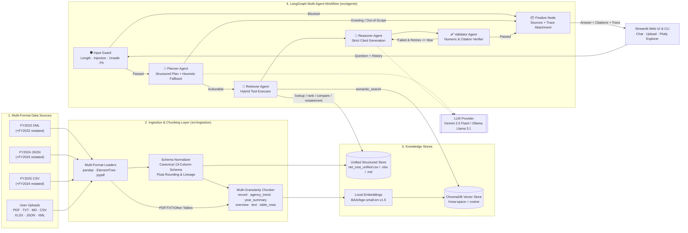
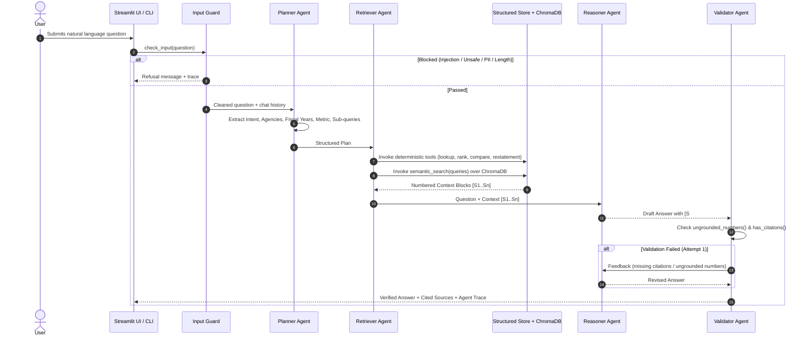

# System Architecture & Technical Documentation

**Project:** U.S. Government Financial Report (USFR) — Multi-Modal Agentic RAG System  
**Category:** Agentic AI Capstone Project

---

## 1. Executive Summary

This system is an autonomous **Agentic Retrieval-Augmented Generation (RAG)** knowledge and decision-support application built over the **Financial Report of the U.S. Government — Statements of Net Cost** dataset (`FY2022–FY2025`), distributed across heterogeneous file formats (**XML**, **JSON**, and **CSV**) plus user-uploaded enterprise documents (**PDF**, **TXT**, **Markdown**, **CSV**, **Excel**, **JSON**, **XML**).

To prevent numeric hallucinations common in vanilla RAG systems over financial tables, the architecture combines:
1. **Multi-Format Schema Normalization & Multi-Granularity Semantic Chunking** into **ChromaDB** using local `BAAI/bge-small-en-v1.5` embeddings.
2. **A 6-Node LangGraph Multi-Agent Workflow** (`input_guard` → `planner` → `retriever` → `reasoner` → `validator` → `finalize`).
3. **Hybrid Retrieval** combining dense vector search with deterministic `pandas` financial tools (`lookup_financials`, `rank_agencies`, `compare_fiscal_years`, `restatement_differences`).
4. **Deterministic Grounding & Citation Validation** that verifies every numeric figure in the LLM's draft against the retrieved context and automatically triggers a self-correction retry loop if any ungrounded number or missing citation is detected.

---

## 2. System Architecture Diagram



---

## 3. End-to-End Data Flow



---

## 4. Mapping to Capstone Project Tasks

| Task # | Capstone Requirement | Implementation in Codebase |
|---|---|---|
| **Task 1** | **Set up the project foundation** | Modular package layout under `src/`, configuration via `.env` and `src/config.py`, CLI (`main.py`, `ingest.py`), and Streamlit UI (`app.py`). |
| **Task 2** | **Design the user interaction layer** | `app.py` provides a 3-tab Streamlit UI (Agentic Chat with live streaming agent trace, Interactive Plotly Financial Explorer, Architecture diagrams) + sidebar multi-file uploader + `main.py` terminal REPL. |
| **Task 3** | **Implement document ingestion** | `src/ingestion/loaders.py` loads **XML**, **JSON**, **CSV**, **Excel (`.xlsx`/`.xls`)**, **PDF**, **TXT**, and **Markdown**. Normalizes heterogeneous USFR schemas (API field names in XML/JSON vs. display headers in CSV) into a 13-column canonical table (`net_cost_unified.csv`, `.xlsx`, `.md`). |
| **Task 4** | **Prepare data for semantic search** | `src/ingestion/documents.py` constructs semantic chunks at 4 granularities (`record`, `agency_trend`, `year_summary`, `overview`) for financial data so numbers are never severed from agency/year labels, plus `RecursiveCharacterTextSplitter` (`900` chars, `150` overlap) for free-text PDFs/TXT and row-grouped chunks for generic tables. |
| **Task 5** | **Build a vector-based knowledge store** | `src/vectorstore.py` uses local open-source HuggingFace embeddings (`BAAI/bge-small-en-v1.5`, normalized cosine similarity) persisted to `chroma_store/` with deterministic SHA-1 chunk IDs for idempotent upserts. |
| **Task 6** | **Implement intelligent document retrieval** | `src/agents/tools.py` & `retriever` node combine multi-query vector similarity search (`semantic_search`) with metadata-aware structured tools (`lookup_financials`, `rank_agencies`, `compare_fiscal_years`, `restatement_differences`). |
| **Task 7** | **Develop a RAG pipeline** | `reasoner` node injects numbered context blocks `[S1]..[Sn]` with strict system instructions requiring every factual statement to carry `[S#]` citations and prohibiting unverified mental math. |
| **Task 8** | **Implement agent-based reasoning** | `src/agents/graph.py` implements a 6-node **LangGraph** state machine with conditional routing, tool execution, and self-correction retry loops. |
| **Task 9** | **Add reliability and safety controls** | `src/guardrails.py` enforces input validation (length limit, prompt-injection regexes, unsafe content filters, SSN/credit-card PII detection), upload sanitization (`save_upload`), heuristic planner fallback when the LLM is unreachable, and deterministic output numeric grounding (`ungrounded_numbers`). |
| **Task 10** | **Deploy and document the solution** | Full documentation in `README.md`, `PRD.md`, and `docs/ARCHITECTURE.md`, interactive diagrams in `src/diagrams.py`, and automated test suite in `tests/test_system.py`. |

---

## 5. Detailed Agent Roles (`src/agents/graph.py`)

1. **`input_guard` (Safety & Input Validation Node)**
   - **Role:** Deterministic pre-LLM gatekeeper.
   - **Checks:** Rejects empty or overly long queries (`>1000` chars), blocks prompt-injection attempts (e.g., *"ignore previous instructions"*, *"reveal your system prompt"*, *"jailbreak"*), filters unsafe requests, and blocks accidental PII submission (SSNs, credit card numbers).
2. **`planner` (Intent & Query Decomposition Agent)**
   - **Role:** Uses `get_llm().with_structured_output(Plan)` to analyze the user question and recent conversation history (`last 6 turns`).
   - **Outputs (`Plan` schema):**
     - `intent`: `lookup` | `ranking` | `comparison` | `trend` | `restatement` | `definition` | `general` | `greeting` | `out_of_scope`
     - `standalone_question`: Self-contained rewrite resolving pronouns/follow-ups (e.g., *"What about 2024?"*).
     - `agencies`: Canonical agency names resolved via fuzzy matching and 35+ federal abbreviations (`DoD`, `HHS`, `SSA`, `VA`, `USPS`, `OPM`, etc.).
     - `fiscal_years`, `metric`, `top_n`, `ascending`, `include_restated`, and `search_queries`.
   - **Resilience:** Automatically falls back to `_heuristic_plan()` if structured output fails.
3. **`retriever` (Hybrid Tool Executor Agent)**
   - **Role:** Executes deterministic `pandas` financial tools and multi-query `semantic_search` based on the `Plan`, assembling deduplicated, numbered context blocks `[S1]..[Sn]`.
4. **`reasoner` (Grounded Synthesis Agent)**
   - **Role:** Generates a clear, markdown-formatted response strictly grounded in `[S1]..[Sn]` with inline citations. If invoked on a retry from the Validator, incorporates the Validator's specific error feedback.
5. **`validator` (Deterministic Output Verification Agent)**
   - **Role:** Parses all numbers in the generated answer (`_numbers()`), accounts for unit conversions (`billions` ↔ `trillions`), verifies every figure appears in the retrieved context within rounding tolerance, and confirms all `[S#]` citations exist. Routes back to `reasoner` if validation fails (up to `MAX_VALIDATION_RETRIES`).
6. **`finalize` (Output & Trace Assembler)**
   - **Role:** Attaches only the cited source objects, appends a transparency note if validation retries were exhausted, and returns the complete execution trace to the UI/CLI.

---

## 6. Setup & Deployment Guide

### 6.1 Local Environment Setup

```bash
# 1. Create and activate virtual environment
python3 -m venv .venv
source .venv/bin/activate

# 2. Install dependencies
pip install -r requirements.txt

# 3. Configure environment variables
cp .env.example .env
# Edit .env and set GEMINI_API_KEY=<your_key> (or set LLM_PROVIDER=ollama for local Llama 3.1)
```

### 6.2 Building / Refreshing the Knowledge Base

```bash
# Ingest default USFR XML (FY2023), JSON (FY2024), and CSV (FY2025) files:
python ingest.py --reset

# Ingest additional PDF, Excel, CSV, or TXT documents from the command line:
python ingest.py path/to/report.pdf path/to/table.xlsx
```

### 6.3 Running the Application

```bash
# Launch the Streamlit Web UI:
streamlit run app.py

# Or run the interactive CLI REPL:
python main.py

# Run the automated test suite:
pytest -v
```

### 6.4 Cloud / Container Deployment (Streamlit Community Cloud / Docker)

1. Push the repository to GitHub (`.env` is excluded via `.gitignore`).
2. In **Streamlit Community Cloud**, select `app.py` as the entrypoint and add `GEMINI_API_KEY` under **App Settings → Secrets**.
3. On startup, `ensure_knowledge_base()` in `app.py` automatically bootstraps `data/raw/` and populates `chroma_store/` and `data/processed/net_cost_unified.csv` if not already present.

---

## 7. Limitations & Challenges Faced During Development

### 7.1 Challenges Addressed
1. **Heterogeneous Multi-Format Schemas:** The Treasury Fiscal Data files arrive in three different formats across fiscal years: `FY2023` as XML (`<data-element>` records with API field names like `gross_cost_bil_amt`), `FY2024` as nested JSON (`{"data": [...]}`), and `FY2025` as CSV with human-readable headers (`Gross Cost (in Billions)`).
   - *Solution:* Built `FIELD_MAP` and `normalize_net_cost()` in `src/ingestion/loaders.py` to unify all formats into a single 13-column schema with source lineage.
2. **Floating-Point Precision Artifacts in Source Data:** Raw XML and JSON records contained IEEE-754 representation artifacts (e.g., `1.39999999999999` instead of `1.4`).
   - *Solution:* Rounded all normalized billion-dollar columns to 1 decimal place during ingestion to match official Treasury tables.
3. **Prior-Year Restatements:** Each annual USFR file contains both the current fiscal year (`restatement_flag = 'N'`) and restated comparative figures for the prior fiscal year (`restatement_flag = 'Y'`). Naive aggregation would double-count FY2023 and FY2024.
   - *Solution:* Implemented `FinancialDataStore.preferred()` to prioritize originally reported figures by default while preserving restated rows for dedicated restatement analysis (`restatement_differences` tool).
4. **LLM Arithmetic Hallucinations:** LLMs frequently miscalculate multi-row sums or year-over-year percentage changes.
   - *Solution:* Offloaded all rankings, lookups, YoY deltas, and restatement diffs to deterministic `pandas` tools, and added `ungrounded_numbers()` in the `validator` node.

### 7.2 Current Limitations & Future Work
- **Scanned PDFs (OCR):** `pypdf` extracts embedded text from digital PDFs; scanned image-only PDFs require an OCR pre-processing step (e.g., Tesseract or Document AI).
- **Dataset Scope:** The pre-loaded Treasury tables cover the *Statements of Net Cost* (`FY2022–FY2025`). Questions about federal tax revenues (*Statement of Operations and Changes in Net Position*) or balance sheet liabilities (*Balance Sheets*) require uploading those corresponding files via the sidebar uploader.
- **Single-Pass Retry Cap:** Output validation retries are capped at `MAX_VALIDATION_RETRIES=1` to keep end-to-end latency low.

